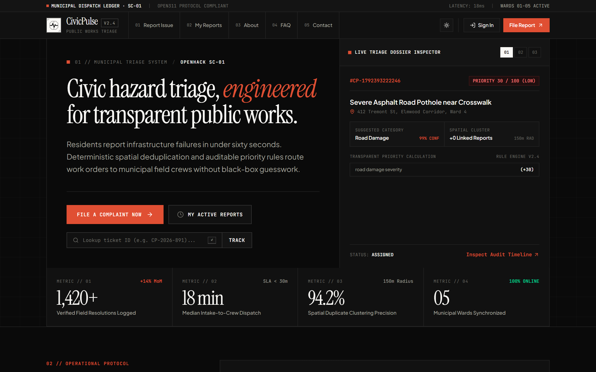
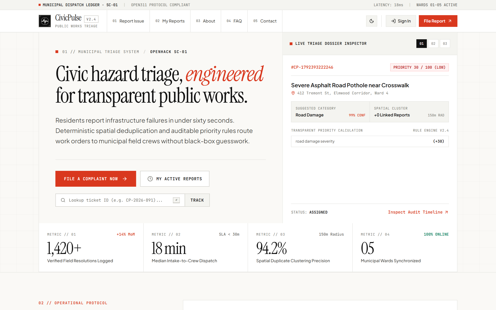
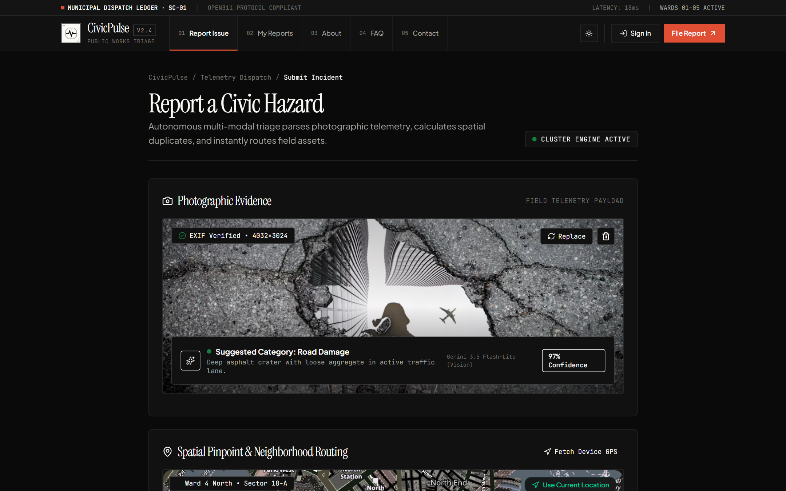
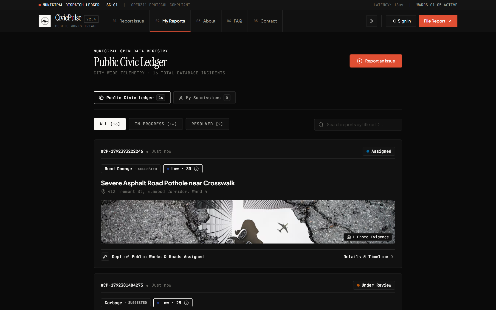
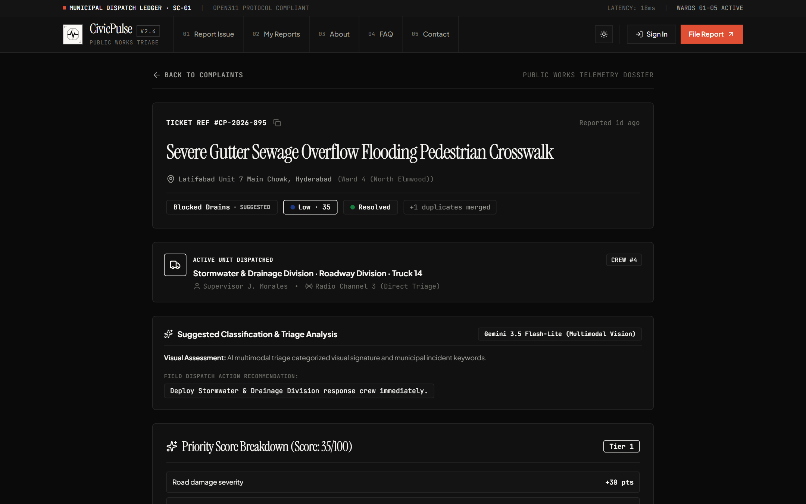
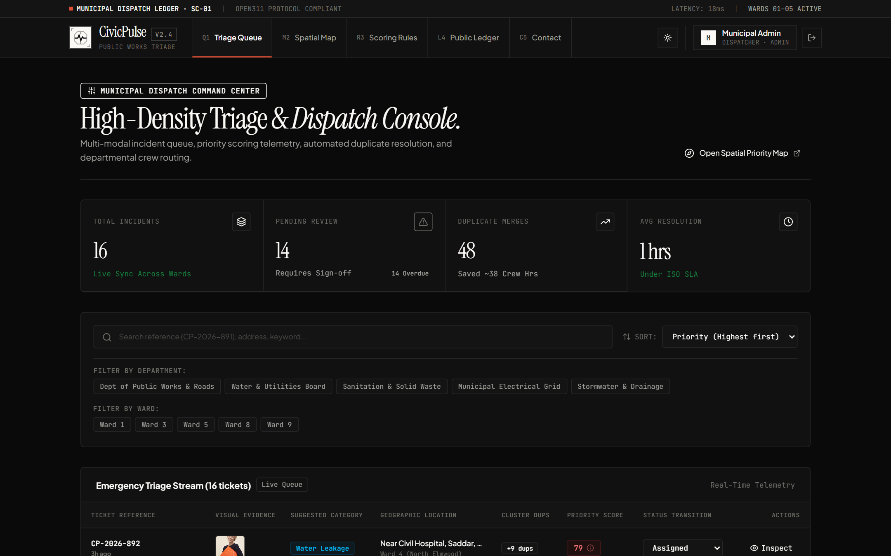
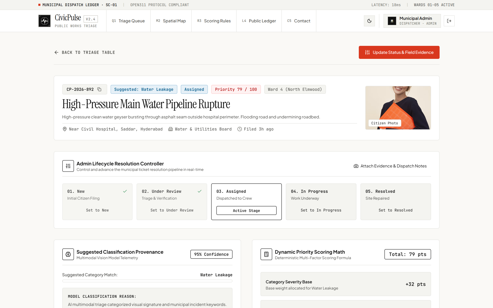
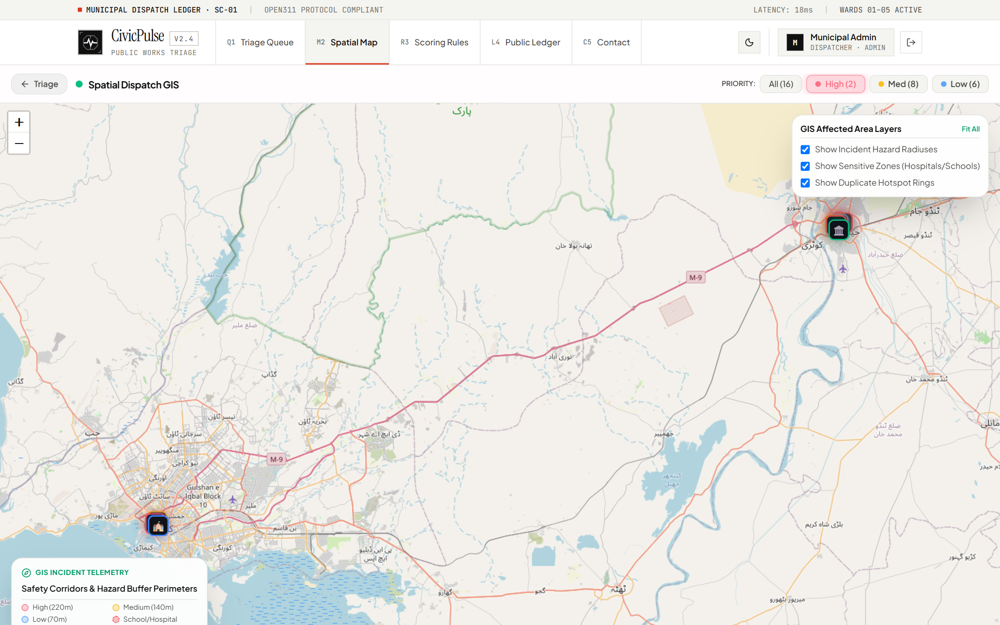
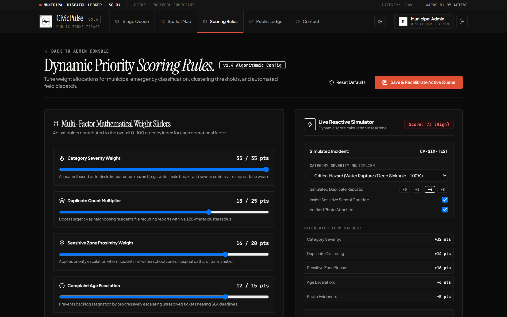
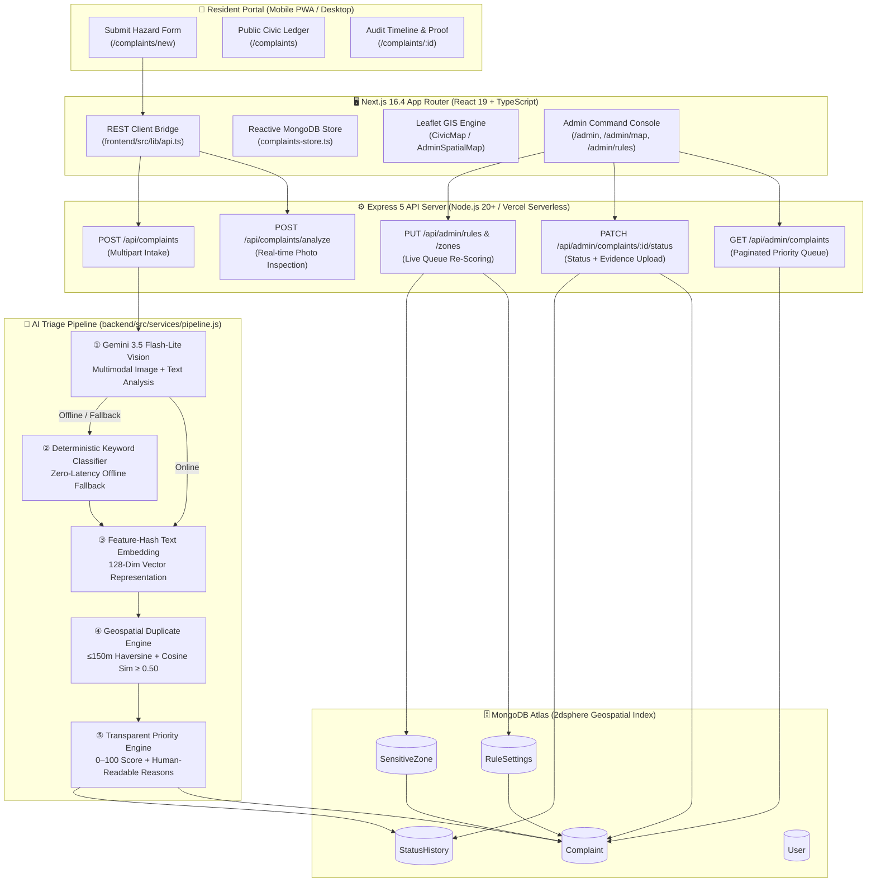

<div align="center">


# CivicPulse — Smart Civic Complaint Triage System (SC-01)

**Autonomous Multi-Modal Municipal Hazard Triage, Spatial Deduplication & Transparent Dispatch Ledger**  
*Built for **OpenHack'26** · Problem Statement **SC-01 (Smart Communities & Public Services)***

[](https://civicpulze.vercel.app)
[](https://civic-triage.vercel.app)
[](https://github.com/naqvi110k/civic-triage)
[](https://github.com/Muhammadumad/civic-triage)

[](https://nextjs.org/)
[](https://react.dev/)
[](https://expressjs.com/)
[](https://www.mongodb.com/)
[](https://ai.google.dev/)
[](https://civicpulze.vercel.app)
[](#-testing--verification)

> **One-Line Pitch:** *Residents report a civic problem in under 60 seconds with a photo and GPS pin; the system automatically classifies the hazard via multimodal AI, clusters duplicate reports within 150 meters, and computes a transparent 0–100 priority score so municipal crews resolve the most critical infrastructure failures first.*

</div>

---

## 🔗 Live Links & Quick Access

| Environment / Resource | Direct URL | Notes |
| :--- | :--- | :--- |
| 🌐 **Primary Live Application** | [**https://civicpulze.vercel.app**](https://civicpulze.vercel.app) | Unified Full-Stack Deployment (Next.js 16 + Express 5 Serverless + MongoDB Atlas) |
| 🌐 **Mirror Live Application** | [**https://civic-triage.vercel.app**](https://civic-triage.vercel.app) | Secondary Production Mirror |
| 📝 **File a Civic Complaint** | [**https://civicpulze.vercel.app/complaints/new**](https://civicpulze.vercel.app/complaints/new) | Multimodal Gemini Vision auto-fill + interactive 150m GPS pin |
| 📖 **Public Civic Ledger** | [**https://civicpulze.vercel.app/complaints**](https://civicpulze.vercel.app/complaints) | Live city-wide registry of reported & resolved incidents |
| 🔐 **Sign In / Demo Presets** | [**https://civicpulze.vercel.app/login**](https://civicpulze.vercel.app/login) | One-click **Admin** and **Resident** demo authentication presets |
| 🛡️ **Admin Triage Console** | [**https://civicpulze.vercel.app/admin**](https://civicpulze.vercel.app/admin) | Priority-sorted queue, SLA tracking, and department dispatch *(Admin Auth)* |
| 🗺️ **Admin Spatial GIS Map** | [**https://civicpulze.vercel.app/admin/map**](https://civicpulze.vercel.app/admin/map) | Hazard radius buffers (220m/140m/70m), school/hospital zones, hotspot rings |
| ⚙️ **Dynamic Rules Engine** | [**https://civicpulze.vercel.app/admin/rules**](https://civicpulze.vercel.app/admin/rules) | Live mathematical weight sliders & real-time queue recalculation |
| 🩺 **API Health Telemetry** | [**https://civicpulze.vercel.app/api/health**](https://civicpulze.vercel.app/api/health) | Live backend status, uptime, and MongoDB connection state |
| 📊 **Open311 Transparency API** | [**https://civicpulze.vercel.app/api/complaints/transparency**](https://civicpulze.vercel.app/api/complaints/transparency) | Real-time resolution rates, SLA turnaround hours, and category breakdown |

---

## 👥 Demo Credentials (One-Click Presets Available on `/login`)

| Persona | Email | Password | Capabilities |
| :--- | :--- | :--- | :--- |
| **Municipal Admin** | `admin@demo.com` | `admin123` | Full access to Triage Queue (`/admin`), Spatial GIS Map (`/admin/map`), Dynamic Scoring Rules (`/admin/rules`), Duplicate Merge/Reject, and Resolution Evidence upload |
| **Citizen / Resident** | `resident@demo.com` | `resident123` | Submit hazard reports (`/complaints/new`), manage personal submissions, track live audit timelines, and reopen unresolved cases within 72 hours |

---

## 📸 Visual Product Tour (Live Application Screenshots)

### 1. Public Landing Page & Live Triage Dossier Inspector (Dark & Day Modes)
Built on the **Google Stitch** editorial design system featuring high-contrast typography (`Instrument Serif`, `Plus Jakarta Sans`, and `JetBrains Mono`), live transparency metrics, direct ticket lookup, and instant Day/Night theme switching.

| Obsidian Dark Mode (`/` Default) | Warm Alabaster Day Mode (`/`) |
| :---: | :---: |
|  |  |

---

### 2. Resident Hazard Intake with Gemini 3.5 Flash-Lite Multimodal Vision (`/complaints/new`)
When a resident attaches a photo, `/api/complaints/analyze` inspects the image via **Gemini 3.5 Flash-Lite Vision** (with a deterministic local keyword fallback), automatically populating the suggested category, confidence score, hazard title, visual assessment, and 150m spatial cluster check.



---

### 3. Public Civic Ledger (`/complaints`) & Resident Audit Timeline (`/complaints/[id]`)
Every submitted report is recorded on the **Public Civic Ledger** with full transparency into its priority score breakdown, assigned municipal department, duplicate links, and verifiable **Before & After** photographic resolution evidence.

| Public Civic Ledger (`/complaints`) | Incident Telemetry Dossier (`/complaints/[id]`) |
| :---: | :---: |
|  |  |

---

### 4. Municipal Admin Command Center — High-Density Triage & Dispatch Console (`/admin`)
Authenticated municipal dispatchers access a priority-sorted emergency triage stream with live KPI cards (Total Incidents, Pending Review, Duplicate Merges, Avg Resolution Time), department/ward filters, server-side pagination, and inline status transitions.



---

### 5. Admin Incident Lifecycle Controller & Priority Math Breakdown (`/admin/complaints/[id]`)
Staff can inspect full AI classification provenance, verify the exact point-by-point priority math, confirm or reject suspected duplicates, assign field crews, and upload photographic resolution proof.



---

### 6. Admin Spatial Dispatch GIS Map (`/admin/map`) & Dynamic Priority Rules Engine (`/admin/rules`)
- **Spatial Dispatch GIS (`/admin/map`)**: Renders interactive Leaflet markers with dynamic hazard radius rings (`220m` High, `140m` Medium, `70m` Low), duplicate hotspot halos, and sensitive municipal safety corridors (schools, hospitals, arterial roads).
- **Scoring Rules Configurator (`/admin/rules`)**: Allows administrators to adjust mathematical weights ($W_{\text{cat}}$, $W_{\text{dup}}$, $W_{\text{zone}}$, $W_{\text{age}}$, $W_{\text{photo}}$) with a live reactive simulator and one-click recalculation across all open complaints in MongoDB.

| Spatial Dispatch GIS Map (`/admin/map`) | Dynamic Priority Scoring Rules (`/admin/rules`) |
| :---: | :---: |
|  |  |

---

## 🏗️ System Architecture & Triage Pipeline



---

## 🧠 Core Algorithmic Engines

### 1. Fail-Safe Multimodal AI Classification (`geminiService.js` + `classifier.js`)
- **Primary Engine**: Uses **Google Gemini 3.5 Flash-Lite** (`@google/genai`) to inspect uploaded hazard photos and text descriptions simultaneously, returning structured JSON with `category`, `confidence`, `suggestedTitle`, `visualHazardSummary`, and `recommendedDepartment`.
- **Deterministic Offline Fallback**: If no API key is configured or the network is offline, `classifier.js` executes regex word-boundary scoring across 5 core municipal categories (`road_damage`, `garbage`, `streetlight`, `water_leakage`, `blocked_drain`) in `< 2ms` so the system never fails during a live demo.

### 2. Spatial & Semantic Duplicate Clustering (`similarity.js` + `utils/geo.js`)
When a new complaint arrives, the pipeline searches open complaints in the same category:
1. **Spatial Proximity**: Computes exact Haversine distance (`calculateDistanceMeters`) and MongoDB `2dsphere` `$nearSphere` queries within a configurable radius ($R \le 150\text{m}$).
2. **Semantic Similarity**: Tokenizes, stems, and hashes descriptions into 128-dimensional vectors to compute **Cosine Similarity**:
   $$S_c(\mathbf{A}, \mathbf{B}) = \frac{\mathbf{A} \cdot \mathbf{B}}{\|\mathbf{A}\| \|\mathbf{B}\|} \ge 0.50$$
3. **Automated Linking & Priority Escalation**: Matching reports are linked via `duplicateOf`, incrementing the parent ticket's `duplicateCount` and automatically recalculating its priority score.

### 3. Transparent Priority Scoring Formula (`priority.js`)
Every complaint receives a deterministic score $P \in [0, 100]$ with an auditable breakdown array (`priorityReasons`):

$$P = \min\Big(100,\; W_{\text{category}} + W_{\text{duplicates}} + W_{\text{sensitiveZone}} + W_{\text{age}} + W_{\text{photo}}\Big)$$

| Factor | Default Allocation | Calculation Rule |
| :--- | :--- | :--- |
| **Category Severity ($W_{\text{category}}$)** | Up to **35 pts** | `water_leakage` (32), `road_damage` (30), `blocked_drain` (28), `streetlight` (22), `garbage` (18) |
| **Duplicate Volume ($W_{\text{duplicates}}$)** | Up to **25 pts** | $\min(25,\; \text{duplicateCount} \times 5\text{ pts})$ |
| **Sensitive Zone Proximity ($W_{\text{sensitiveZone}}$)** | **+20 pts** | Triggered if within radius of an active School, Hospital, or Arterial Corridor |
| **Unresolved Age Escalation ($W_{\text{age}}$)** | Up to **15 pts** | $\min(15,\; \text{daysOpen} \times 2\text{ pts})$ |
| **Verified Photo Evidence ($W_{\text{photo}}$)** | **+5 pts** | Awarded when photographic evidence is attached |

- **Priority Bands**: 🔴 **High** ($P \ge 70$) · 🟡 **Medium** ($40 \le P \le 69$) · 🔵 **Low** ($P < 40$)

---

## 🌐 Complete REST API Reference (19 Endpoints)

| Method | Endpoint | Access | Description |
| :--- | :--- | :--- | :--- |
| `GET` | `/api/health` | Public | Server health, uptime, and MongoDB connection state |
| `POST` | `/api/auth/register` | Public | Register a new resident account with bcrypt password hashing |
| `POST` | `/api/auth/login` | Public | Authenticate user and issue HS256 JWT token |
| `GET` | `/api/auth/me` | Authenticated | Retrieve current authenticated user profile |
| `PUT` | `/api/auth/password` | Authenticated | Change password for authenticated account |
| `POST` | `/api/complaints/analyze` | Public | Multimodal Gemini Vision inspection of uploaded hazard photo |
| `POST` | `/api/complaints` | Public / Optional Auth | Submit new complaint (`photo` + GPS coordinates) through triage pipeline |
| `GET` | `/api/complaints` | Public | Fetch public complaints list with category/status filters |
| `GET` | `/api/complaints/mine` | Resident Auth | Fetch complaints submitted by the logged-in resident |
| `GET` | `/api/complaints/nearby` | Public | Geospatial `2dsphere` radius search (`lat`, `lng`, `radius`) |
| `GET` | `/api/complaints/bounds` | Public | Map viewport bounding-box query (`minLat`, `minLng`, `maxLat`, `maxLng`) |
| `GET` | `/api/complaints/transparency` | Public | Live city-wide resolution rate, SLA turnaround hours, and category stats |
| `GET` | `/api/complaints/:id` | Public | Full complaint details, duplicate parent info, and `StatusHistory` timeline |
| `GET` | `/api/admin/complaints` | Admin Only | Server-side paginated, searchable, priority-sorted triage queue |
| `PATCH` | `/api/admin/complaints/:id/status` | Admin Only | Update status, assign department, and attach resolution `evidence` photo |
| `POST` | `/api/admin/complaints/:id/merge` | Admin Only | Confirm (`merge`) or reject (`unmerge`) suspected duplicate link |
| `GET` | `/api/admin/stats` | Admin Only | Command Center KPIs (total, high priority, resolved, SLA overdue, avg hours) |
| `GET` | `/api/admin/rules` | Admin Only | Fetch active priority scoring weights and sensitive zones |
| `PUT` | `/api/admin/rules` | Admin Only | Update priority weights and bulk-recalculate all open complaints |
| `POST` | `/api/admin/zones` | Admin Only | Register a new Sensitive Zone (school/hospital/road) & re-score open queue |
| `DELETE` | `/api/admin/zones/:id` | Admin Only | Remove a Sensitive Zone & re-score open queue |

---

## 🚀 Getting Started (Local Development)

### Prerequisites
- **Node.js** `v20+`
- **MongoDB** (MongoDB Atlas URI or local `mongodb://127.0.0.1:27017/civic_complaints_db`)

### 1. Clone the Repository & Install Dependencies
```bash
git clone https://github.com/naqvi110k/civic-triage.git
cd civic-triage

# Install root, backend, and frontend dependencies
npm install
cd backend && npm install && cd ..
cd frontend && npm install && cd ..
```

### 2. Configure Environment Variables
Copy `.env.example` to `backend/.env` (and `.env` in root if deploying to Vercel):
```env
PORT=5000
MONGO_URI=mongodb+srv://<username>:<password>@cluster0.mongodb.net/civic_complaints_db?retryWrites=true&w=majority
JWT_SECRET=your_super_secret_jwt_key_here
JWT_EXPIRES_IN=7d
GEMINI_API_KEY=your_gemini_api_key_here
DUP_RADIUS_METERS=150
DUP_SIM_THRESHOLD=0.50
```

### 3. Seed the Database with Realistic Demo Data
```bash
npm run seed
```
> Populates demo accounts (`admin@demo.com` / `resident@demo.com`), 3 sensitive municipal safety corridors (hospitals, schools, arterial highways), default scoring rules, and realistic infrastructure complaints with duplicate clusters and before/after resolution photos.

### 4. Start Backend & Frontend Development Servers

**Terminal 1 — Express 5 Backend (`http://localhost:5000`):**
```bash
cd backend
npm run dev
```

**Terminal 2 — Next.js 16 Frontend (`http://localhost:3000`):**
```bash
cd frontend
npm run dev
```
> `frontend/next.config.ts` automatically proxies `/api/*` and `/uploads/*` requests to `http://localhost:5000` during local development.

---

## 🧪 Testing & Verification

Run the zero-dependency algorithmic unit test suite verifying keyword classification, stemming & cosine similarity math, Haversine distance calculations, and priority score formulas:

```bash
npm run test:logic
```

Run a full production build check:

```bash
npm run build
```

---

## 📁 Repository Structure

```text
civic-triage/
├── api/
│   └── index.js                       # Vercel Serverless Function entry bridge for Express 5
├── backend/
│   ├── server.js                      # Standalone HTTP server entry point (port 5000)
│   ├── src/
│   │   ├── app.js                     # Express 5 app setup, CORS, rate limiting, static uploads
│   │   ├── config/db.js               # Mongoose 9 connection manager with serverless caching
│   │   ├── middleware/                # auth.js (JWT + RBAC), upload.js (Multer), errorHandler.js
│   │   ├── models/                    # Complaint, User, StatusHistory, RuleSettings, SensitiveZone
│   │   ├── routes/                    # auth.js, complaints.js, admin.js, healthRoutes.js
│   │   ├── services/                  # geminiService.js, classifier.js, similarity.js, priority.js, pipeline.js
│   │   ├── utils/geo.js               # Haversine distance & coordinate validation helpers
│   │   ├── seed/seed.js               # Municipal demo dataset seeder
│   │   └── tests/logic.test.js        # 15 unit tests for AI classification, similarity & priority math
│   └── uploads/                       # Sample & uploaded infrastructure hazard evidence
├── frontend/
│   ├── public/                        # PWA manifest.json, sw.js, icons, and static assets
│   └── src/
│       ├── app/                       # Next.js 16 App Router pages
│       │   ├── page.tsx               # Public landing page, live dossier inspector & GIS map
│       │   ├── (auth)/                # /login & /register with 1-click Demo Presets
│       │   ├── (resident)/complaints/ # /complaints (Public Ledger), /new, and /[id] tracking
│       │   ├── (admin)/admin/         # /admin queue, /map spatial GIS, /rules engine, /complaints/[id]
│       │   └── (public)/              # /about, /faq, /contact, /privacy, /terms
│       ├── components/                # Leaflet map wrappers, SensitiveZoneManager, PwaManager, Navbar
│       ├── context/                   # PersonaContext (Auth + Role) & ThemeContext (Dark/Light)
│       └── lib/                       # api.ts (REST client bridge) & complaints-store.ts
├── docs/
│   ├── screenshots/                   # Live application screenshots for documentation
│   └── TASKS.md                       # Complete Phase 1–10 execution log
├── spec.md                            # Product specification & acceptance criteria
├── plan.md                            # Engineering architecture & mathematical specification
├── AGENTS.md                          # Repository conventions & AI agent engineering rules
├── vercel.json                        # Unified full-stack Vercel routing configuration
└── package.json                       # Root workspace scripts & unified build pipeline
```

---

## 📑 Documentation Index

- **[`spec.md`](./spec.md)** — Product specification, target personas, user stories, and demo acceptance criteria.
- **[`plan.md`](./plan.md)** — Technical architecture, database schemas, and mathematical scoring formulas.
- **[`AGENTS.md`](./AGENTS.md)** — Engineering rules, layer boundaries, and code quality standards.
- **[`docs/TASKS.md`](./docs/TASKS.md)** — Complete phase-by-phase engineering changelog (Phases 1–10).

---

<div align="center">
  <sub>Built with craft for <b>OpenHack'26 (Problem SC-01)</b> · <a href="https://civicpulze.vercel.app">Live Demo</a> · <a href="https://github.com/naqvi110k/civic-triage">GitHub</a></sub>
</div>
